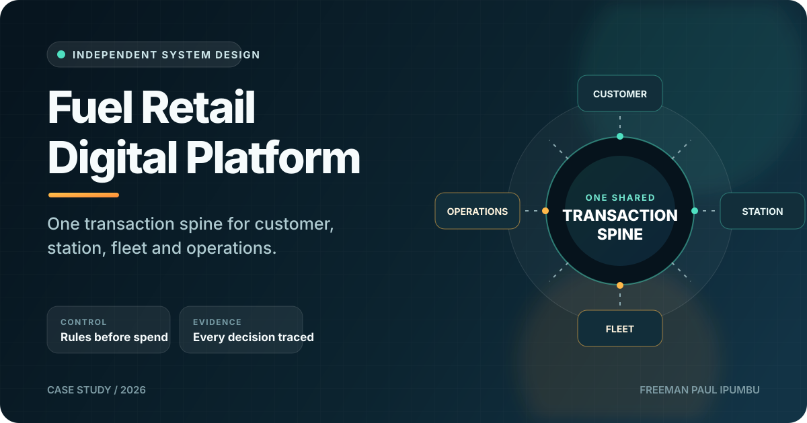
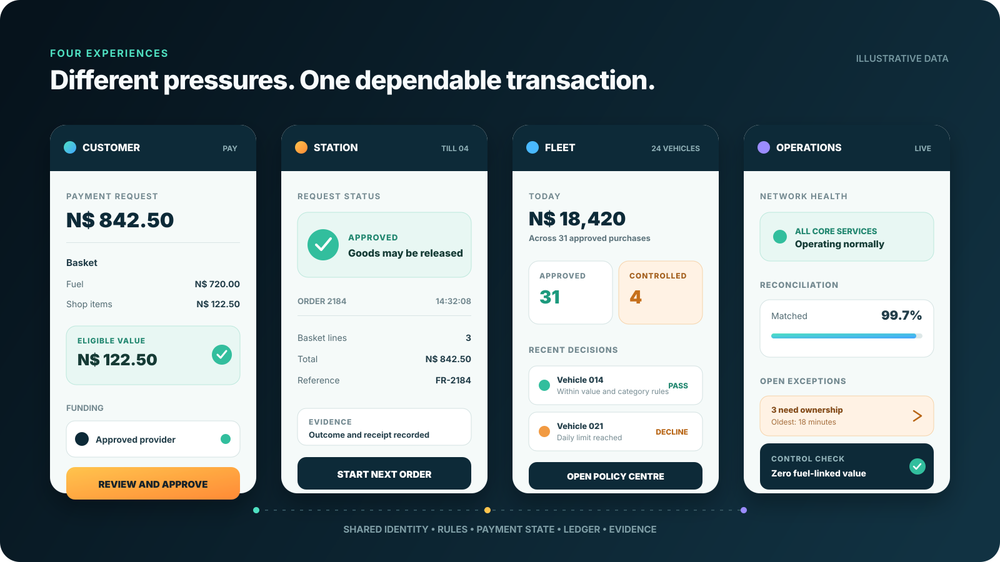
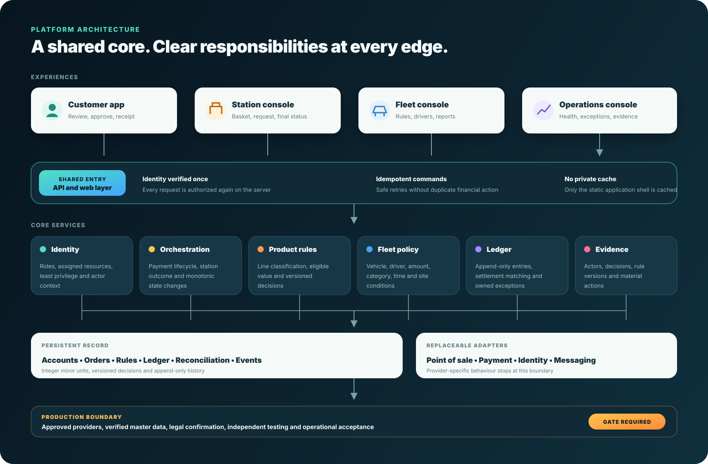
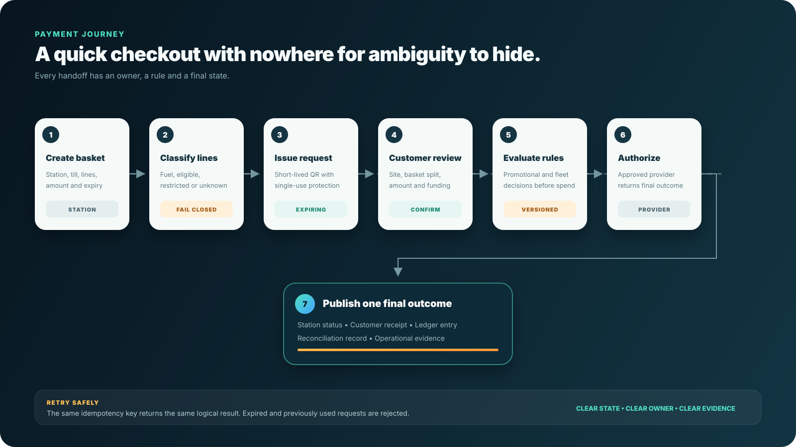

# Fuel Retail Digital Platform



One transaction can look like four different jobs.

The customer wants a quick checkout. The station needs clear confirmation before releasing goods. A fleet manager wants spend rules enforced before money moves. Operations needs the full decision trail when something goes wrong.

This case study brings those jobs onto one transaction spine. It covers a customer wallet, station checkout, fleet controls and an operations console, with the hard rules built into the system instead of left to memory.

> This is an independent controlled-pilot concept. It is not a live financial service, a production-certified payment product or evidence of a client relationship.

## The brief

Design a practical digital platform for a regulated fuel-retail environment without blurring commercial ambition and operational control.

The concept had to answer five questions:

1. How does a customer pay without slowing down the station?
2. How does a business control vehicle spend before approval?
3. How are mixed baskets handled when fuel and shop items follow different rules?
4. How does the station know a payment is final?
5. How can finance, support and risk reconstruct every material decision later?

## The product shape

| Surface | Job it owns | What the user sees |
| --- | --- | --- |
| Customer app | Review and approve a payment request | Basket split, amount, funding choice, receipt and history |
| Fleet console | Set rules before drivers spend | Vehicles, drivers, limits, categories, alerts and reports |
| Station console | Create and close the sale safely | Till context, basket, expiring QR request and final status |
| Operations console | Keep the network explainable | Health, exceptions, reconciliations, rules and evidence |



## One rule sits at the centre

Fuel earns no promotional benefit, and promotional value cannot reduce the fuel portion of a basket.

That sounds simple until a basket contains fuel, food and a car wash. The platform classifies every line, calculates the eligible non-fuel total, evaluates the active rule version and records the result. Unknown items default to ineligible until reviewed.

This is not a warning in the interface. It is a system invariant applied before approval and preserved in the evidence trail.

## The transaction spine



The four experiences share a small set of dependable services:

- identity and scoped authorization
- transaction orchestration with idempotent commands
- product classification and promotional rules
- fleet policy evaluation
- an append-only ledger and reconciliation path
- operational events that explain who did what, when and under which rule version
- replaceable adapters for point-of-sale, payment, identity and messaging providers

The provider boundary matters. The prototype can use a deterministic simulator for safe evaluation while the customer, station and fleet flows remain ready for an approved provider later.

## How a payment moves



1. The station imports or enters a classified basket.
2. The platform creates a short-lived payment request and presents a QR code.
3. The customer reviews the station, basket split, amount and funding method.
4. Promotional and fleet rules are evaluated before authorization.
5. The approved provider returns a final outcome.
6. The station sees a clear result before releasing goods.
7. The ledger, receipt, reconciliation record and operational event are written from the same outcome.

Retries reuse the same idempotency key. Expired or previously used QR requests cannot be approved again. Ambiguous product classification fails closed for promotional value.

## Prototype evidence

The working prototype was exercised against the decisions most likely to fail under pressure:

- mixed-basket approval with promotional value limited to eligible non-fuel lines
- rejection of promotional value against fuel
- insufficient customer balance
- fleet amount and category declines
- an in-policy fleet purchase
- a station-created QR request and customer approval handoff
- single-use approval and replay rejection
- persistence after reload
- scoped roles across customer, station, fleet and operations views
- append-only operational events for material actions
- responsive checks across the principal surfaces

This proves the product logic at prototype level. It does not replace provider certification, legal review, security testing or operational acceptance.

## A pilot designed to teach

The recommended first move is a bounded pilot across a small, mixed-site cohort. Invite a controlled customer group, include a representative set of fleet vehicles and keep promotional eligibility narrow.

The pilot should answer:

- Do customers complete payment without staff intervention?
- Does the station receive a reliable final status quickly enough?
- Do settlement records reconcile to orders and provider outcomes?
- Do fleet controls decline the right transactions without blocking normal work?
- Does eligible non-fuel value improve without creating fuel-linked benefit?
- Can support reconstruct an exception from the event trail?

The detailed operating frame is in [docs/pilot-playbook.md](docs/pilot-playbook.md).

## Production gates

The prototype deliberately stops before claims it cannot earn. A live rollout still needs:

- jurisdiction-specific legal confirmation
- approved point-of-sale and payment-provider interfaces
- identity and role mapping
- verified station, product and eligibility data
- settlement, refund and reconciliation specifications
- independent security, load, recovery and accessibility testing
- privacy notices, retention periods and support ownership
- a formal operational acceptance decision

## What this case study demonstrates

- product architecture across customer, retail, fleet and operational workflows
- policy translated into enforceable software rules
- payment-state and reconciliation thinking
- security boundaries that fail closed
- a pilot model built around measurable evidence
- interface design for users with very different pressures

## Repository guide

- [Architecture](docs/architecture.md) explains the service boundaries, data choices and security posture.
- [Decision record](docs/design-decisions.md) captures the choices that keep the platform safe and adaptable.
- [Pilot playbook](docs/pilot-playbook.md) defines readiness, measurement and incident handling.
- [Publication note](docs/publication-note.md) explains what was intentionally rebuilt or excluded for this public version.
- [Public-safety check](scripts/verify-public-safe.sh) scans the repository for client identifiers and secret-like values.

Run the release check with:

```sh
./scripts/verify-public-safe.sh
```

## Built by SolarSpin Technologies

This public case study was designed and documented by **[SolarSpin Technologies](https://www.solarspin-namibia.xyz/)**, led by [Freeman Paul Ipumbu](https://freeman-ipumbu.pages.dev/).

SolarSpin keeps the commercial prospect anonymous here. The case study shows the system thinking without exposing private product source, protected infrastructure or the identity of the organisation involved.

The repository uses the terms in [LICENSE](LICENSE).
